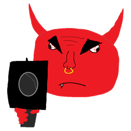
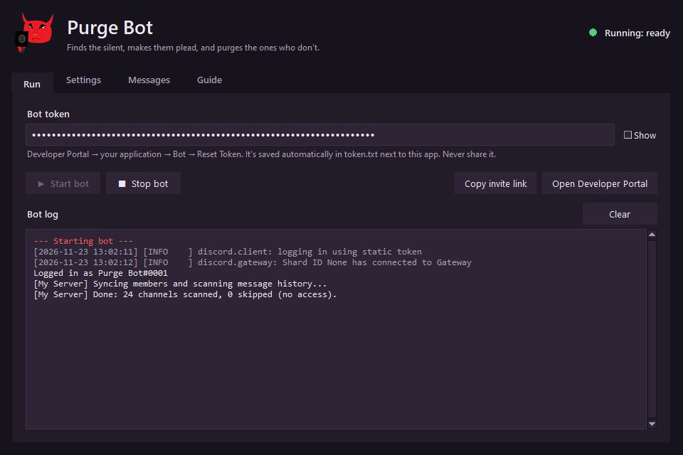

<p align="center"></p>

<h1 align="center">Purge Bot 😈</h1>

<p align="center"><b>Finds the lurkers in your server and makes them plead for mercy.</b></p>

Purge Bot is a comically evil Discord bot for cleaning up inactive members. It finds everyone who hasn't written anything for a year, DMs them a survey asking why they should stay, lets your moderators vote on the answers, and kicks the people who never reply.

It doesn't need to run all the time. Start it when you want to work on the purge, and it catches up on everything that happened while it was off. It comes with a desktop app for starting the bot, editing its settings and messages, and reading the guide.

<p align="center"></p>

## Features

- **Finds inactive members** by reading a year of message history in every channel and thread it can see.
- **DMs them a survey** in a comically evil voice, and gives them a few days to plead their case.
- **Lets mods vote** on each answer with ✅ keep, 👢 kick or 🔨 ban, even while the bot is offline.
- **Kicks those who stay silent** after the deadline, and carries out the mods' votes, when the server owner confirms it.
- **Sends reminders** to people who haven't answered yet.
- **Works offline.** Replies and votes that arrive while the bot is off are picked up at the next start.
- **Desktop app** with a start/stop button, live log, settings, editable DM texts and a built-in guide.

## How a purge works

1. **Start the bot.** It syncs the member list and reads the message history of every channel it can see. The first time it reads back a full year, which can take a few minutes. Later starts only read what's new.
2. **`!inactive`** lists everyone with no messages for a year.
3. **`!survey confirm`** DMs each of them the survey. They have 3 days to reply, in as many messages as they like.
4. **Mods vote.** Each answer is posted in your review channel with ✅ 👢 🔨 underneath.
5. **`!process`** shows what will happen, and **`!process confirm`** does it:
   - People who didn't reply before the deadline are **kicked**.
   - People whose answers got enough votes are **kept, kicked or banned**.
   - Everyone else stays on the waiting list.

| Day | What you do |
|---|---|
| 1 | Start the bot → `!inactive` → `!survey confirm` → stop the bot |
| Any time | Mods react to the answers in the review channel |
| Optional | `!remind` to nudge those who haven't answered |
| 4+ | Start the bot → `!process` → `!process confirm` → stop the bot |

## Getting started

### 1. Install

You need [Python](https://www.python.org/downloads/) 3.10 or newer. Then, in the project folder:

```
pip install -r requirements.txt
```

The app is built and tested on Windows. The bot itself (`Bot.py`) runs anywhere Python does.

### 2. Create the bot in Discord

1. In the [Discord Developer Portal](https://discord.com/developers/applications), create an application and open **Bot**.
2. Turn on **Server Members Intent** and **Message Content Intent**.
3. Click **Reset Token** and copy the token.

The token works like a password for your bot. Never share it or commit it. It's saved in `token.txt`, which git ignores. If it ever leaks, reset it in the Developer Portal.

### 3. Open the app and add the token

Double-click **`PurgeBot.pyw`** (or `PurgeBot.exe` if you've [built it](#building-purgebotexe)) and paste the token into the **Bot token** field. It's saved automatically.

### 4. Invite the bot to your server

Click **Copy invite link** in the app and open the link. The bot asks for: View Channels, Read Message History, Send Messages, Embed Links, Add Reactions, Kick Members and Ban Members. You need the Manage Server permission to add it.

To build the link by hand, fill in your Application ID (Developer Portal → General Information):

```
https://discord.com/oauth2/authorize?client_id=YOUR_APPLICATION_ID&scope=bot&permissions=85062
```

Then, in **Server Settings → Roles**, drag the bot's role **above** the roles of anyone it might need to kick. Discord won't let a bot kick someone with a higher or equal role.

The bot only sees activity in channels it can read. People who only write in channels hidden from the bot will look inactive.

### 5. Start it and pick a review channel

Press **Start bot** in the app. Create a channel that only mods can see, and type in Discord:

```
!setup #purge-review
```

You're ready to purge.

### Without the app

Put the token alone in a `token.txt` file next to `Bot.py`, then run:

```
python Bot.py
```

## Commands

Type these in a channel in your server. All of them need the **Kick Members** permission. Those marked **owner** can only be used by the server owner.

| Command | Who | What it does |
|---|---|---|
| `!setup #channel` | owner | Sets the review channel where answers are posted for voting |
| `!status` | mods | Overview: inactive, waiting, answered, ready to process |
| `!inactive` | mods | Lists inactive members and their survey status |
| `!survey` | owner | Shows who would get the survey |
| `!survey confirm` | owner | Sends the survey DMs |
| `!remind` | owner | DMs a reminder to surveyed members who haven't answered yet (their deadline stays the same) |
| `!process` | mods | Shows who would be kicked, banned or kept, and who is still waiting |
| `!process confirm` | owner | Carries out what `!process` showed |
| `!exempt @member` | mods | Excludes a member from the purge. Run it again to include them again |
| `!exempt` | mods | Lists everyone who is exempted |
| `!scan` | mods | Rescans members and messages (also done automatically on startup) |
| `!help` | anyone | Lists the commands |

## Rules the bot follows

- **Never purged:** bots, the server owner, anyone with Kick Members or Administrator permission, exempted members, and anyone who joined less than a year ago.
- **Activity** means sending a message in a channel or thread. Voice chat and reactions can't be read from history, so they don't count.
- **Answers** can be text, images, files, voice messages or stickers, spread over as many DMs as the member likes. The bot waits until they've been quiet for 10 minutes, then posts everything together for the mods and sends them a "plea delivered" DM. Anything they send later is added to the post.
- **Voting:** a decision needs 2 mod votes and a clear winner. A tie, or a mod reacting with more than one option, means no decision yet. Only reactions from mods count.
- **Deadlines:** a reply that arrives after the deadline still counts if it comes in before `!process` is run. Someone who is still writing at the deadline isn't kicked.
- **Writing in the server** after being surveyed takes a member off the list automatically.
- **Exempting** someone who was already surveyed ends their survey straight away: no reminders, no kick, their review post is marked as exempted, and they get the "spared" DM. The same happens if a surveyed member becomes a mod.
- **Kept members** are safe for another full year.
- **Closed DMs:** if the bot can't DM someone, they're posted for a vote straight away and are never kicked automatically.
- **Before a kick or ban** the bot DMs the member to tell them why.
- **Changing the review channel** with `!setup` is safe. Answers already posted stay in the old channel, and votes there still count. If the old channel is deleted, its answers are reposted in the new one.

## Settings

Change these on the app's **Settings** and **Messages** tabs. They're saved in `settings.json`, and the defaults live in [config.py](config.py). Stop and start the bot after changing them.

| Setting | Default | Meaning |
|---|---|---|
| `INACTIVE_DAYS` | 365 | Days without a message before someone counts as inactive |
| `RESPONSE_DAYS` | 3 | Days members get to answer the survey |
| `ANSWER_QUIET_MINUTES` | 10 | Minutes of silence after a member's last reply before it goes to the mods |
| `MIN_VOTES` | 2 | Mod votes needed for a decision |
| `DM_DELAY_SECONDS` | 3 | Pause between DMs, so Discord doesn't flag the bot as spam |
| `COMMAND_PREFIX` | `!` | What commands start with |

The five DMs the bot sends (survey, plea received, spared, purged and reminder) can be edited on the **Messages** tab. In each of them, `{name}`, `{server}`, `{deadline}` and `{quiet}` are filled in for you, and Discord formatting like `**bold**` works.

## Testing safely

- Use a separate test server and a separate test bot with its own token, so your real server isn't touched.
- **Settings → Use test values** makes everyone without mod permissions count as inactive and gives them about 4 minutes to reply. A yellow banner on the Run tab reminds you while they're active.
- Click **Settings → Restore real defaults** and save before using the bot on your real server.

## Building PurgeBot.exe

Run **`build_exe.bat`**. It installs PyInstaller and Pillow, makes the icons from `purgeBot.png`, and builds `PurgeBot.exe` into the project folder.

The .exe keeps `token.txt`, `settings.json` and `Members.json` in the folder it's in, so keep it in the project folder or move those files along with it.

## Your data

Everything the bot stores stays on your computer, in files git ignores:

| File | Contains |
|---|---|
| `token.txt` | Your bot token |
| `settings.json` | Your settings and DM texts |
| `Members.json` | Member names, last activity, survey answers and the review channel |

`Members.json` is saved about once a minute, after every command that changes something, and when the bot stops. Don't edit it while the bot is running. If you delete it, the bot rebuilds it on the next start, but ongoing surveys and the review channel setting are lost.

## Troubleshooting

| Problem | Fix |
|---|---|
| "Discord rejected the token" | Reset the token in the Developer Portal and paste the new one |
| "Turn on ... Intent" | Developer Portal → Bot → turn on both intents |
| Bot is offline in Discord | It's only online while it's running |
| Bot ignores `!` commands | Message Content Intent is off, or you lack the Kick Members permission |
| No posts in the review channel | Check that the bot can post, embed links and add reactions there |
| "Can't kick ..." | Move the bot's role above that member's roles |

## Project layout

```
PurgeBot.pyw            Opens the app
Bot.py                  Starts the bot (the app runs this for you)
config.py               Default settings and DM texts; loads settings.json and the token
requirements.txt        Python packages needed
build_exe.bat           Builds PurgeBot.exe
purgeBot.png            The Purge Bot picture (source for all icons)
assets/
  make_icons.py         Makes icon.png, header.png and purgebot.ico from purgeBot.png
  screenshot.png        The app screenshot in this README
gui/
  app.py                The app window and its tabs
  bot_process.py        Starts and stops the bot and collects its log
  guide.py              The Guide tab's text
  theme.py              Colors and styles
cogs/
  events.py             Startup, joins/leaves, name changes, messages, DM replies
  mod_commands.py       The ! commands
inactivity/
  storage.py            Loading and saving Members.json
  activity.py           Member sync, history scan, finding inactive members
  surveys.py            Sending surveys and reminders, reading replies, review posts
  decisions.py          Counting votes, kicking, banning and keeping
  helpers.py            Small shared helpers (dates, permissions, messages)
```

## License

[MIT](LICENSE)
